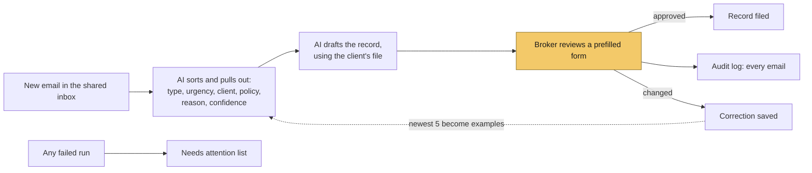

> [!ai]- Summary
> **What it is:** An AI workflow that reads an insurance brokerage's shared inbox, drafts the record a staff member would normally type out, and sends it to a broker to check. Every email, approval, and correction is logged, and the broker's corrections feed back into the AI's instructions. Demo build, made-up data.  
> **Problem:** Someone reads every email, figures out which client and policy applies, and types a record into the brokerage's main system with dates to follow up. These emails aren't tidy.  
> **My role:** Designer and builder. Build time: 6 days, while learning n8n.  
> **Status:** Working demo, not in production. Nothing is filed until a person approves it.  
> **Outcome:** On a scored test of 12 deliberately messy emails, it got every email's type right, as well as 71 of 72 details. All for about fifth of a cent per email.  
> **Methods:** n8n (self-hosted) · Claude Haiku 5.5 · Gmail · Claude Code

## The problem

An insurance brokerage runs on its shared inbox. Clients write in to add a car, ask why their renewal went up, report a fender bender, and so on. Insurers write in asking for paperwork. Someone reads every email, figures out which client and policy applies, and types a record into the brokerage's main system (in this example, Applied Epic) with dates to follow up. In this business, that record is also the brokerage's protection if something goes wrong later. 

These emails aren't tidy. One client mentions two policies in one message. Another asks "my son is driving my car now, is that OK?", which is really a request to add a driver. An insurer's request sits buried two messages down a forwarded thread under "see below." A reply still has "Renewal" in the subject line, but the client is writing to say they're moving. 

The list goes on. Simple keyword rules can't sort these, and a broker's time is better spent advising clients, shopping renewals, and bringing in new business.

![[site-assets/gmail-inbox-12-test-emails.png]]
*Shared inbox with 12 test emails*

## Scope and design principles

- **A person approves everything.** The broker's version — never the AI's — is what gets filed.
- **The AI reads and writes, but the rules decide.** The fields that drive the brokerage's work, like priority, owner, follow-up, date, come from fixed rules the brokerage controls.
- **Nothing is estimated.** Every run is scored against an answer key written before the AI steps were built, and priced from its token counts.

## The workflow

The setup: "Callander & Reid", a small Ontario independent brokerage with six clients and eleven policies, that uses n8n, a workflow tool (running on my own machine), Claude to read the emails, and Gmail as the shared inbox.

*What the workflow does.*

![[site-assets/n8n-workflow-labelled.png]]
*The whole workflow in n8n.*

### 1) The AI reads the email

It decides what kind of request it is, how urgent it is, which client and policy it's about, and what changed. The AI also explains why it read the email that way and says how sure it is. When the AI can't tell which policy an email covers, it says so instead of guessing

### 2) The AI drafts the record

A drafting call, which is a separate request to the same model, gets the email, what the step 1 "Sort and pull out" found, and the client's file. It writes the record's one-line description and its note. It drafts a follow-up email only when the brokerage needs something from the client.

### 3) Fixed rules fill in the rest

The record's code, priority, owner, and follow-up date come from the brokerage's rules, not the AI. The record's code, priority, owner and follow-up date come from deterministic rules, not the AI. They come out the same way every time, and the brokerage can change them without touching the prompt. 

### 4) A broker checks it

The broker gets one review email at a time, with the original email, how the AI reads it, and a form already filled in with the draft. Emails that need a closer look are flagged. The broker fixes what's wrong and clicks "approve". 

### 5) Everything is logged

Every email gets an audit record, and every change the broker makes is saved as a before-and-after pair.

![[site-assets/gmail-n8n-review-email-jenna.png]]

*A flagged review email.*

![[site-assets/n8n-review-form-jenna.png]]

*The form shows Priority Low, the one miss covered under What We Measured.*****

### Where it lands

Approved records show up on the mock Epic screen, and every run shows up on the dashboard.

![[site-assets/mock-epic-approved-activity-e07.png]]

*The mock Epic screen, with Jenna's approved activity in the open activities list showing the broker's fix of setting Low to Normal.*

![[site-assets/dashboard-sh-after-demo-run.png]]

*A dashboard showing what came in, what was approved as drafted, what was corrected, what failed, and what it cost.*

## Key design decisions

### A fixed pipeline, not an AI agent

Here, every email takes the same path, so there's nothing for an agent to decide. The AI does the reading and writing inside two fixed steps. A fixed path is easier to test, explain, and trust. 

### A person approves everything

Nothing goes into the brokerage's system without a person signing off. I could've sent only the flagged emails to the broker, but that would defeat the point. The flags tell the broker what to focus on, not what to skip.

### It speaks the brokerage's language

I researched how Applied Epic actually labels things and used its field names and activity codes. [One example: I'd been calling follow-ups "suspense items". In Epic, "suspense" means something else entirely, and a broker would have caught it immediately. — "suspense items" needs a quick definition here, given the industry-agnostic reader intended for this case study]

### The cheaper model was more accurate and discerning (surprisingly)

I ran the same 12 emails through Claude Haiku 5.5 and Claude Sonnet 5.5, the bigger model. Haiku got 12/12 types and 71/72 details right. Sonnet got 11/12 and 70/72 — at about 13 times the cost per email. 

Sonnet's wrong type was telling. It trusted a reply's old subject line ("RE: RE: Your Kestrel Bay renewal") over what the client actually wrote (he's moving). Real inboxes are full of emails with mismatched subject-body content. The takeaway: test models on your own mail. Don't assume the expensive one is safer.

![[site-assets/csv-haiku-vs-sonnet-scores.png]]
*Scored runs 6 and 7: the same 12 emails and the same prompt. Haiku got more right at about a thirteenth of the cost per email.*

## Evaluation and evidence

Before building the AI steps, I wrote down the right answer for every test email's type and detail, with a definition of what each field means. A script scores each run against that answer key and prices its from token counts n8n saves with every run. Nothing in this case study is an estimate. 

**The final scored run**:

| What                                                             | Result                            |
| ---------------------------------------------------------------- | --------------------------------- |
| Email types right                                                | 12 of 12                          |
| Details pulled out right                                         | 71 of 72                          |
| Record fields right (code, priority, client code, policy number) | 47 of 48                          |
| Cost per email                                                   | $0.00195, about a fifth of a cent |

Both misses are the same mistake. The AI marked a request for "pink slips" (Ontario's proof-of-insurance card) as Low urgency, and the rules set Priority from urgency, so the one miss shows up in both lines. The AI's written reasons took "pink slips" to mean vehicle ownership papers, not proof of insurance. A broker would mark it Normal, because driving without one can get you a ticket. I chose not to tune the instructions to that one email, as it would've raised the score without making the AI any better on new mail.

### Did the correction stick?

That pink-slip email became a test for the feedback loop. Every correction a broker makes is saved, and the five newest priority and code corrections go into the AI's instructions as examples. 

There was one wrinkle — the AI didn't get that email wrong every time. It marked it "Low" about half the runs, on the exact same instructions. Showing one good run after the fix would have proved nothing. Instead, I ran each email 60 times before the correction and 60 times after.

**Test results**:

| | Marked Low, before | Marked Low, after one broker correction |
| --- | --- | --- |
| The original email | 32 of 60 | 0 of 60 |
| A new, similar email | 14 of 60 | 0 of 60 |

With the example added, the 12 test emails kept their type and urgency scores across two check runs. 

![[site-assets/n8n-review-form-e07-priority-fix.png]]

*The broker changing Jenna's Priority from Low to Normal.*

![[site-assets/n8n-review-form-e13-normal.png]]

*A pink-slip request from a different client, Heather Gill, arriving as Normal on its own.*

### What This Doesn't Prove

The brokerage, clients, insurers, and emails are made up. Twelve test emails are not a real inbox, the system is a mock of Applied Epic, and time saved wasn't measured, because there was no real "before" to measure against. The AI's confidence rating — high, medium, low — is a label it gives itself, based on whether it had to guess the type, client, or policy. It's not a measured probability, and it wasn't scored. Every number in this case study was measured, and none goes further than what was measured.

## What broke

### The AI's output kept breaking its own format

n8n's error said only "Model output doesn't fit required format." The saved run below showed the real cause: one closing brace too many at the end, so the output wasn't valid JSON. Moving one short field to the end of the output took broken replies from 3 of 5 to 0 of 12, with no change to the wording. Later, Claude turned on n8n's auto-fix option, which sends any malformed output to a second model call to repair it. In the two scored runs since, it wasn't needed.

![[site-assets/n8n-draft-entry-invalid-json.png]]
*The saved run: the model's reply ends with one closing brace too many (`}}}`), so n8n's parser rejects it.*

### The drafts asked clients for things the brokerage already knew

For example, their own policy number. A broker would notice that immediately. The fix was to hand the AI the client's file before it drafts.

### The AI described its own process in the notes 

Lines like "Sorting labelled these as vehicle titles" showed up in 14 of 145 drafted activity notes, the write-up a broker reads in Epic, across several test runs. A rule fixed it by giving the model the words to use instead of only banning the habit. For example, it now writes "the email doesn't say which policy" in place of "sorting couldn't tell." That brought it to 0 of 12. 

## How I worked with Claude Code

### What I did

The design and the key decisions. Claude proposed some, and I approved or rejected. I built the main workflow's nodes myself in n8n, as well as the feedback loop. The one exception is a format-repair node that  Claude added. I also set up the broker and sender accounts and credentials, and reviewed the test emails and answer key.

### What Claude Code did, at my direction

Claude came up with the clients and their concerns, and drafted their test emails and the answer key. I reviewed the key's judgment calls and built the data workflow that feeds the dashboard. Claude also wrote the scoring scripts, researched Applied Epic's field names, activity codes, and screens, and built the mock Epic screen. It built the dashboard and added the format-repair node.

### Checking the AI's work

Claude's work got checked like everything else. In the first scored run, two of its mistakes surfaced. The scoring script marked a correct client name wrong, which was a bug in the script. And the answer key rejected a valid name on a joint account. The workflow's own AI caught that one: its written reason for the email showed the key was too strict. I approved the fix, and the score went from 70 to 71 out of 72. That's the payoff of asking the AI to explain every answer: its reasons can expose mistakes in the checking, not just in the AI. 

### When a rule fails, add a check

Early on, Claude pushed a Google login secret to the project's private GitHub repo. A written rule told it not to, and it did anyway. A rule can only ask Claude not to do something. An automated check can stop it. After replacing the secret, I added gitleaks, a secret scanner, as a pre-commit hook: a check git runs before every commit, which refuses any commit that contains a secret. Two days later, it blocked a commit of saved test runs that held n8n's encrypted logins, before they left my machine.

## Result and current status

**Still in progress:** [TO DO]

**What I learned:** [TO DO]

## Methods and tools

- **n8n (self-hosted):** the workflow tool, running on my own machine.
- **Claude Haiku 5.5:** reads the emails and drafts the records. Chosen over Claude Sonnet 5.5 after a scored head-to-head.
- **Gmail:** the shared inbox.
- **Claude Code:** see "How I worked with Claude Code."
- **Answer-key scoring:** a script scores each run against the answer key and prices it from token counts.
- **Repeated runs:** 60 runs before and 60 after a broker correction, because the AI's mistake only happened some of the time.
